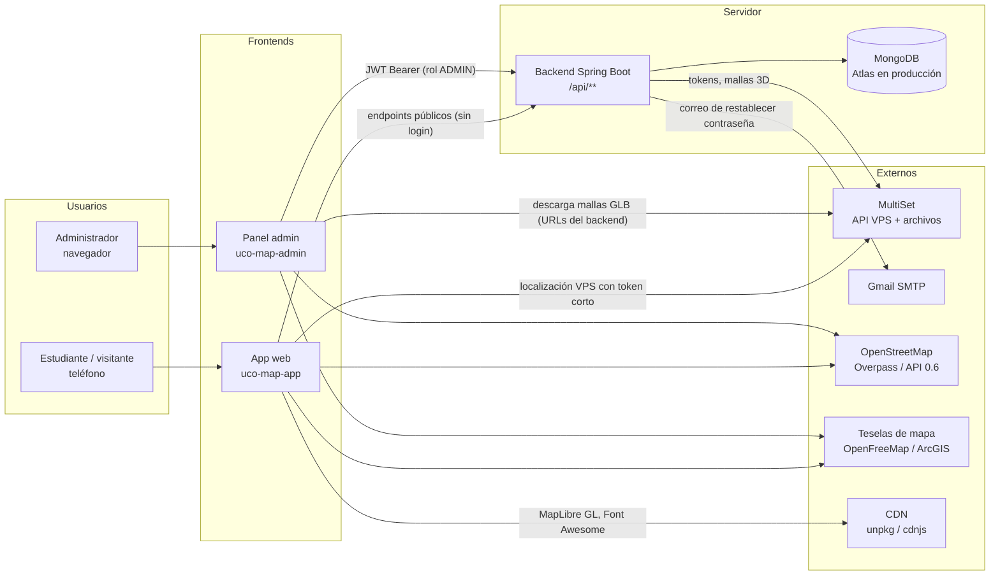
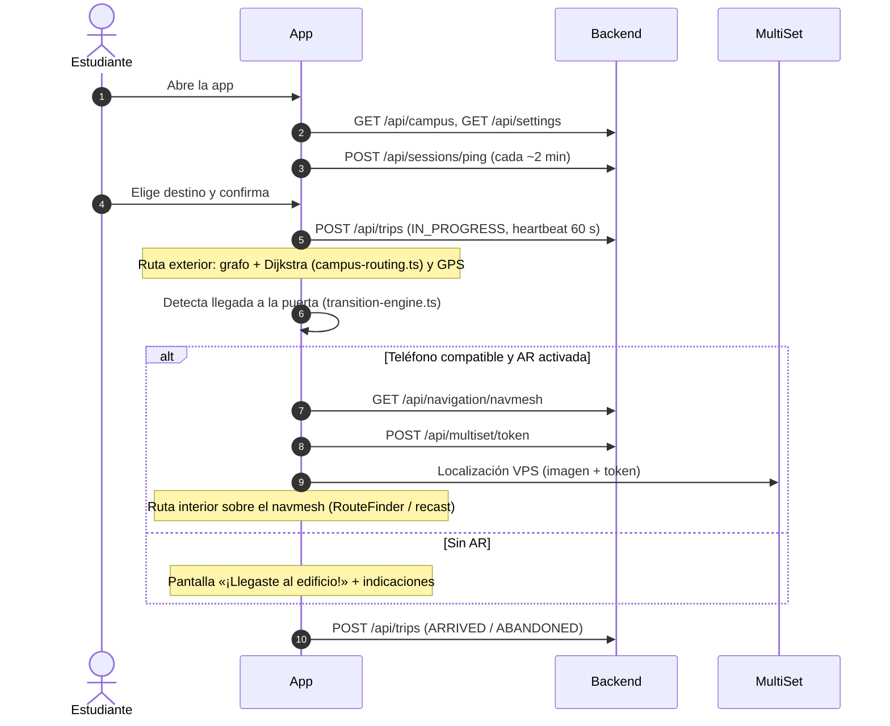
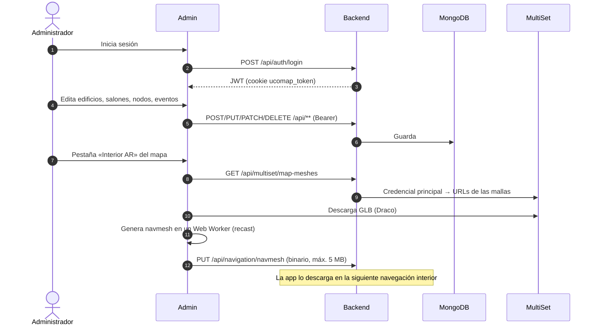

# UCO MAP: arquitectura del ecosistema

> Documento compartido: existe **idéntico** en `docs/ECOSISTEMA.md` de los tres repositorios (backend, admin y app).
> Si lo cambias, cópialo a los otros dos.
>
> Todo lo que aparece aquí se comprobó en el código (noviembre de 2026). Lo que no se pudo verificar desde los
> repositorios está marcado con **(por confirmar)** y debe preguntarse al responsable del proyecto.

## 1. Qué es UCO MAP

UCO MAP guía a estudiantes y visitantes por el campus de la Universidad Católica de Oriente (UCO):

- **Exterior:** un mapa con GPS calcula la ruta por los senderos del campus hasta la puerta del edificio.
- **Interior:** en teléfonos compatibles, una guía con cámara (realidad aumentada) muestra el camino dentro del
  edificio hasta el salón o punto de interés. La posición se obtiene con un VPS (*Visual Positioning System*)
  de MultiSet.
- **Administración:** un panel web donde el equipo mantiene edificios, salones, el grafo de caminos, los puntos AR,
  la malla de navegación interior (*navmesh*), los eventos del campus y consulta la analítica de uso.

## 2. Repositorios

| Módulo | Repositorio | Tecnología | Despliegue actual |
|---|---|---|---|
| **Backend** (API) | `KronoIV/ms-ucoMap-backend` (público) | Java 21, Spring Boot 3.5.14, MongoDB | Railway: `https://ucomap-backend.up.railway.app` (URL tomada del `.env` de admin y app). La forma exacta de despliegue en Railway **(por confirmar)**; el repo trae `Dockerfile`. |
| **Admin** (panel) | `KronoIV/uco-map-backoffice` (público) | React 19, Vite 8, TypeScript 6, MUI 7 | Netlify **(por confirmar)**: `public/_redirects` es de Netlify y el backend arma el enlace de restablecer contraseña con `https://uco-map.netlify.app`. |
| **App** (estudiantes) | `KronoIV/uco-map-app` (privado) | Vite 8, TypeScript 5.6 sin framework, three.js 0.150.1, WebXR, recast-navigation | **(por confirmar)**: el README antiguo hablaba de Netlify y de un `netlify.toml` que no existe en el repo. |

Los tres repos son independientes (no hay monorepo). En la máquina del equipo anterior estaban como carpetas
hermanas: `backend/`, `uco-map-admin/` y `uco-map-app/`. **Conserva esa disposición**: los scripts
`check:routing` y `check:brand` del admin comparan archivos con `../uco-map-app`.

## 3. Arquitectura general

## 4. Responsabilidad de cada módulo

| Módulo | Es dueño de | No hace |
|---|---|---|
| **Backend** | Persistencia en MongoDB, reglas de negocio (grafo, edificios ⇄ nodos, eventos, viajes, analítica), autenticación JWT, rate limit, correo, intermediario de MultiSet (guarda el secreto y entrega tokens cortos), almacén del navmesh publicado. | No calcula rutas ni genera el navmesh. |
| **Admin** | Edición de datos del campus, editor del grafo exterior (Leaflet/MapLibre), visor 3D de los escaneos (three.js), **generación del navmesh** en el navegador (recast-navigation en un Web Worker) y su publicación, eventos, usuarios, configuración y tableros de analítica. | No lo usan los estudiantes. |
| **App** | Experiencia del estudiante: búsqueda de destinos, ruta exterior con GPS, transición exterior → interior, guía AR con motor propio (WebXR / cámara + VPS + navmesh), llegada, y envío de telemetría (sesiones y recorridos). | No escribe datos del campus; solo usa endpoints públicos. |

## 5. Comunicación entre módulos

### 5.1 Contrato HTTP del backend

- Prefijo `/api`. JSON. Toda respuesta correcta va envuelta: `{ "data": ..., "succeeded": true, "message"?: "..." }`
  (`common/dto/ApiSuccess.java`). Errores: `{ "error": "<mensaje>", "succeeded": false, "details"?: {campo: mensaje} }`
  (`common/dto/ApiError.java`, `common/error/GlobalExceptionHandler.java`).
- Excepciones al sobre: `GET /api/navigation/navmesh` (binario), `POST /api/multiset/token` (objeto plano
  `{token, expiresAt, mapSetCode}`), `GET /api/trips/export` (CSV) y `GET /api/sessions/stream` (SSE).
- El admin desenvuelve el sobre automáticamente en `src/services/api.ts` (interceptor de Axios). La app usa
  `unwrapApi()` de `src/services/campus-api.ts`.
- Listados paginados (`/api/sessions`, `/api/trips`): `PageResponse {content, page, size, totalElements, totalPages}`.

### 5.2 Autenticación

- Solo el **admin** inicia sesión: `POST /api/auth/login` → JWT (HS256, 24 h por defecto). El admin lo guarda en
  la cookie `ucomap_token` (no es HttpOnly; la escribe JavaScript) y lo envía como `Authorization: Bearer <token>`.
- La **app** no tiene usuarios: identifica el dispositivo con un UUID propio (`uco_device_id` en `localStorage`).
- Endpoints públicos (sin token), definidos en `backend/.../security/config/SecurityConfig.java`:
  `POST /api/auth/{login,forgot-password,reset-password}`, `POST /api/sessions/ping`, `POST /api/trips`,
  `GET /api/trips/popular`, `GET /api/campus/**`, `GET /api/buildings/**`, `GET /api/rooms/**`, `GET /api/graph/**`,
  `GET /api/settings/**`, `GET /api/navigation/navmesh`, `GET /api/navigation/elevators`,
  `POST /api/multiset/token`, `GET /api/events/active`. Todo lo demás exige rol `ADMIN`.

### 5.3 Qué consume cada frontend

| Endpoint | App | Admin |
|---|---|---|
| `GET /api/campus` (salones, grafo, bloques en una sola llamada) | ✔ | |
| `GET /api/settings` (banderas como `enableIndoorARNavigation`, `arOnLimitedDevices`) | ✔ | ✔ (CRUD) |
| `GET /api/graph/nodes`, `/edges` | ✔ (mapa exterior) | ✔ (CRUD) |
| `GET /api/navigation/navmesh`, `/elevators` | ✔ | ✔ (publica con `PUT /navmesh`) |
| `POST /api/multiset/token` | ✔ | |
| `GET /api/events/active` | ✔ | (CRUD en `/api/events`) |
| `GET /api/trips/popular` | ✔ | |
| `POST /api/sessions/ping`, `POST /api/trips` (telemetría) | ✔ | (lee `/api/sessions`, `/api/trips`, `/api/analytics`) |
| `/api/buildings`, `/api/rooms`, `/api/poi-clips`, `/api/users`, `/api/navigation/{patches,connections,scan-edits,blocks}`, `/api/multiset/{usage,map-meshes}` | | ✔ |

### 5.4 Código compartido entre admin y app

No hay paquete compartido: son **copias idénticas** que se verifican con `cmp`.

| Admin | App | Verificación |
|---|---|---|
| `src/utils/campus-routing.ts` | `src/navigation/campus-routing.ts` | `npm run check:routing` (en el admin) |
| `src/utils/campus-osm.ts` | `src/navigation/campus-osm.ts` | ídem |
| `src/utils/poi-catalog.ts` | `src/navigation/poi-catalog.ts` | ídem |
| `src/utils/navmesh-input.ts` | `test/eval/experiment/navmesh-input.ts` | ídem |
| `src/theme/uco-brand.css`, `src/assets/uco-logo.svg` | `src/styles/uco-brand.css`, `src/assets/img/uco-logo.svg` | `npm run check:brand` — **hoy falla**: esos dos archivos no existen en la app |

Además, **`recast-navigation` debe tener la misma versión exacta (0.43.0) en admin y app**: el admin genera el
navmesh binario y la app lo carga.

## 6. Flujos de datos principales

### 6.1 Un estudiante va a un salón

### 6.2 El equipo publica cambios del campus

### 6.3 Restablecer contraseña del panel

1. `/forgot-password` del admin → `POST /api/auth/forgot-password`.
2. El backend guarda el hash del token y envía por Gmail un enlace `app.password-reset.frontend-url` + `/reset-password?token=…`.
3. `/reset-password` del admin → `POST /api/auth/reset-password`. Los JWT emitidos antes del cambio dejan de valer.

## 7. Servicios y dependencias externas

| Servicio | Lo usa | Para qué | Credencial |
|---|---|---|---|
| MongoDB Atlas | Backend | Base de datos de producción | `MONGODB_URI` (secreta) |
| Gmail SMTP | Backend | Correo de restablecer contraseña | `MAIL_USERNAME` / `MAIL_PASSWORD` (contraseña de aplicación, secreta) |
| MultiSet (`api.multiset.ai`) | Backend, App, Admin | VPS (localización interior), mallas 3D de los escaneos, cuota | `MULTISET_CLIENT_ID` / `MULTISET_CLIENT_SECRET` solo en el backend; la app recibe tokens cortos |
| Railway | Backend | Hosting de la API | Cuenta del responsable |
| Netlify | Admin (y quizá App) | Hosting estático **(por confirmar)** | Cuenta del responsable |
| Overpass API / OSM API 0.6 | App, Admin | Huellas de edificios y senderos en vivo (`campus-osm.ts`) | Ninguna |
| OpenFreeMap | App, Admin | Estilo/teselas del mapa | Ninguna |
| ArcGIS World Imagery | Admin | Capa satelital | Ninguna |
| unpkg / cdnjs | App (MapLibre GL 5, Font Awesome 6.5.1), Admin (iconos de Leaflet) | Recursos cargados en tiempo de ejecución | Ninguna |

## 8. Orden recomendado para levantar todo en local

1. **MongoDB local** (Docker): `docker run -d --name ucomap-mongo -p 27017:27017 mongo:7`
2. **Backend** (`backend/`): `cp .env.example .env` → `./mvnw spring-boot:run` → `http://localhost:8080`.
   Con la base vacía siembra datos de ejemplo y un usuario administrador (ver README del backend).
3. **Admin** (`uco-map-admin/`): `cp .env.example .env.local` → `npm ci` → `npm run dev` → `http://localhost:5173`.
4. **App** (`uco-map-app/`): `cp .env.example .env.local` → `npm ci` → `npm run dev` → `https://localhost:5174`
   (certificado autofirmado; en el teléfono usa `https://<IP-de-tu-PC>:5174`).

Los README de cada repo explican cada paso en detalle.

## 9. Configuración compartida

| Dato | Dónde se define |
|---|---|
| URL del backend | Admin: `VITE_BACKEND_URL`. App: `VITE_API_BASE` (build) y `BACKEND_URL` (proxy de `npm run dev`). |
| URL del panel admin (enlace del correo) | Backend: `app.password-reset.frontend-url` en `application.properties`. |
| Orígenes CORS | Backend: `app.cors.allowed-origins=*` (cualquier origen). |
| Banderas de funcionalidades | Colección `app_settings` (se editan en Admin › Configuración; la app las lee de `/api/settings`). |
| Map set de MultiSet | Backend: `MULTISET_MAP_SET_CODE` (la app lo recibe junto con el token). |
| Versión de recast-navigation | `0.43.0` exacta en `package.json` de admin y app. |

## 10. Requisitos de infraestructura

- **Desarrollo:** Node.js 22 (verificado con 22.22.2), npm 10, Java 21 (JDK), Docker (para MongoDB) y Git.
  Maven no hace falta: el backend trae `mvnw`.
- **App en teléfono:** HTTPS obligatorio (cámara, GPS, sensores). AR solo en equipos que pasan las reglas de
  `uco-map-app/src/services/ar-device-rules.ts` (Android con WebXR/ARCore o iPhone con iOS 16+, ver
  `uco-map-app/docs/ar-device-capability.md`).
- **Producción:** MongoDB Atlas, Railway (backend), hosting estático con reescritura SPA (admin), cuenta MultiSet
  con cuota suficiente, cuenta Gmail con contraseña de aplicación.

## 11. Consideraciones importantes

- **No apuntes nunca un entorno local a la base de producción.** El backend escribe al arrancar (siembra, índices,
  sincronización de edificios) y la app envía telemetría. Pide un volcado (*dump*) si necesitas datos reales.
- **`npm run dev` de la app usa por defecto el backend de producción** (el `.env` versionado). Define
  `BACKEND_URL=http://localhost:8080` en `.env.local`.
- **MultiSet cobra por llamada.** El backend estima la cuota y apaga la guía con cámara al 98 %
  (`MultiSetUsageService`). No automatices pruebas que llamen al VPS real.
- **Cambiar un contrato rompe dos clientes.** Cualquier cambio de ruta, campo o forma de respuesta en el backend debe
  revisarse en `uco-map-admin/src/services` y `uco-map-app/src/services`. Prefiere cambios aditivos.
- **No hay migraciones de base de datos.** Renombrar un campo de un `@Document` deja los documentos viejos sin ese dato.
- **Los secretos van solo en variables de entorno del backend.** Todo lo que empieza por `VITE_` queda público en el
  JavaScript que descarga el navegador.
